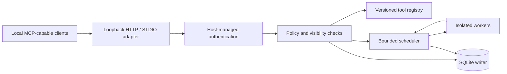

# Architecture and execution topology — FROZEN V1 DESIGN

## Boundary model
Client host -> local HTTP or STDIO adapter -> MCP protocol dispatcher -> verified client principal -> authorization policy -> tool registry snapshot -> execution scheduler -> worker adapter -> tool implementation.
The gateway exclusively owns identity, grants, registry trust state, and transactional metadata/audit access. A worker receives only an opaque execution identifier and constrained capability envelope. It is never a source of trusted actor identity, permission grants, human approval or audit records.

## Control plane / data plane
Control plane: administrative CLI registers clients, stages and verifies tool packages, records trust/enablement and client-scoped grants through gateway-owned service APIs. Data plane: each MCP call authenticates, validates protocol and schema, resolves immutable registered version/digest, evaluates permissions, dispatches through bounded queue, records outcome, transforms errors to client-safe results. Audit writes are mandatory for authorization-sensitive transitions.

## Security invariants
A-01 Never derive principal from client-supplied header/display name alone.
A-02 Authorize discovery independently from invocation; always recheck authorization at dispatch.
A-03 Version/digest pin is part of dispatch identity; no executable mutation under active trusted version.
A-04 Installing never executes tool code or confers trust, enablement, or grants.
A-05 Default deny on missing authorization, storage failure, digest mismatch, policy parse errors or unavailable secure approval interface.
A-06 Workers cannot mutate authoritative gateway state directly.
A-07 No network listener on non-loopback in initial scope; no cloud dependency.

## Trust zones
Z1 privileged gateway and private SQLite database; Z2 owner administrative CLI operating through authenticated trusted admin channel; Z3 locally authenticated MCP clients (not assumed trustworthy); Z4 staged packages (untrusted); Z5 tool workers (untrusted until independently proven otherwise). No Z4/Z5 object may gain Z1 authority through environment variables, filesystem inherited handles, writable gateway package folders or IPC data.

## Startup/shutdown
Startup acquires singleton store-writer lock, validates config permissions, initializes/migrates DB transactionally, validates trusted manifest digests, binds loopback listener, advertises readiness only when policy registry and audit storage are healthy. Failure before readiness exits nonzero and remains inaccessible. Graceful shutdown stops admission, cancels queued work, observes bounded active-work deadline, records outcomes, flushes WAL, releases resources. Hard crash triggers recovery reconciliation on next start; an in-flight tool's side effect is UNKNOWN unless explicit idempotency contract proves completion.

## Worker execution
Trusted narrowly reviewed builtins may use in-process execution only under a separate allowlist. Third-party code MUST use OS-enforced containment with tested filesystem/network/process/token restrictions; unvalidated isolation means refuse execution, not weaker fallback. Worker channel uses authenticated, bounded, versioned messages with one request ID per invocation; maximum sizes and lifetime enforced before deserialization. Native C++/Rust workers implement the same envelope; they do not receive SQLite paths or administrative secrets.

## Windows portability
Windows 10 first. Define platform interfaces for atomic file replacement, process identity, filesystem ACL, restricted execution, secrets store and IPC. Unix ports must implement and qualify equivalent guarantees rather than simulate Windows-specific permissions.

## Scope boundary
This is a central tool service, not a general agent orchestration framework. Model lifecycle, prompts, long-term memory, remote management, unrestricted script execution and multimodal interaction are outside the initial release.

## Architecture freeze gate
Must ratify MCP revision, authentication/approval transport, worker isolation mechanism, exact persistence/IPC contracts, supported OS editions, security threat model, resource budgets and requirement-to-test mapping. This architecture is governed by `ARCHITECTURE_FREEZE_V1.md` and immutable `phase0-architecture-v1`. Runtime implementation and security testing remain unperformed; design freeze does not authorize code.
